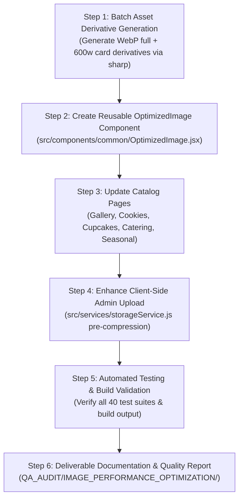

# GoodNews Cake and Catering: Image Optimization Architecture & Technical Strategy

**Document Version:** 1.0.0  
**Author:** Senior Web Performance Engineer & Frontend Architecture Specialist  
**Target:** GoodNews Cake and Catering Application  
**Execution Phase:** Pre-Implementation Plan (Awaiting Authorization)

---

## 1. Strategy Overview & Core Objectives

The goal of this image optimization strategy is to achieve **ultra-fast image delivery across all mobile, tablet, and desktop devices without any perceptible degradation in image quality, color vibrancy, or cake decoration sharpness**.

```
+---------------------------------------------------------------------------------------------------+
|                                  IMAGE OPTIMIZATION PIPELINE                                     |
|                                                                                                   |
|   Original High-Res Assets (PNG/JPG)  --->  Sharp 0.35.5 (libvips) Pipeline                       |
|                                                     |                                             |
|                     +-------------------------------+-------------------------------+             |
|                     |                                                               |             |
|          1. High-Res WebP (Q=88)                                         2. Card WebP (600w, Q=85)|
|          For "View Details" Modal & Zoom                                 For Catalog Grid Displays |
|          (800-1200px, 60-80% payload cut)                                (600px, 85-92% payload cut)|
|                     |                                                               |             |
|                     +-------------------------------+-------------------------------+             |
|                                                     |                                             |
|                                                     v                                             |
|                              React <OptimizedImage /> Component                                   |
|                              - <picture> with WebP <source> & PNG/JPG fallback                   |
|                              - Responsive srcset & sizes                                         |
|                              - Native lazy-loading & high fetchpriority for first 2-3 items      |
|                              - Progressive blur/skeleton placeholder & zero CLS layout container  |
|                              - Graceful fallback on network glitch                               |
+---------------------------------------------------------------------------------------------------+
```

---

## 2. Technical Architecture Pillars

### Pillar 1: Modern Format Conversion (WebP with Lossless Perceptual Fidelity)
1. **Preserve Originals:** All original image files (`.png`, `.jpg`, `.webp`) remain intact in the codebase to ensure 100% backward compatibility.
2. **Generate High-Quality WebP Derivatives:**
   - **Quality Parameter:** Set strictly to `quality: 88` with `effort: 6` (maximum compression search with no visual noise or compression banding).
   - **Alpha Transparency:** For silhouette and cut-out cake images (`cake1.png`, `cake2.png`, `cake4.png`, `cake5.png`, `cake6.png`, `cake7.png`, `cake8.png`, `catering1.png`, `catering2.png`, `catering3.png`, `catering4.png`, `catering6.png`, `catering7.png`, `catering8.png`), WebP preserves 100% alpha transparency with clean anti-aliased contours.
   - **Color Profiling:** Preserve standard sRGB color profiles to ensure the red velvet reds,Adey Abeba goldens, and strawberry glazes look rich and appetizing on iPhone OLED, iPad, and high-end desktop displays.

### Pillar 2: Multi-Resolution Responsive Delivery
Food photographs require different resolutions depending on user viewport:
1. **Catalog Grid Cards (`card-600w.webp`):**
   - Resolution: Max width `600px` (or height `600px` maintaining aspect ratio).
   - At a 300px CSS card width on a 2x Retina screen, 600px provides pixel-for-pixel crystal clarity.
   - Average size: **25 KB to 75 KB** (down from 350 KB - 614 KB).
2. **Modal View Details / High-Res (`full.webp`):**
   - Full original resolution (800px – 1200px).
   - Loaded when the customer clicks "View Details" to inspect the sugar pearls, piped lace, and delicate cross motifs.
   - Average size: **60 KB to 180 KB**.

### Pillar 3: Resilient `<OptimizedImage>` React Component
A modular, battle-tested image component will be introduced (`src/components/common/OptimizedImage.jsx`):
- Uses standard `<picture>` HTML markup:
  ```html
  <picture>
    <source type="image/webp" srcset="/images/cakes/cake1-card.webp 600w, /images/cakes/cake1.webp 1200w" sizes="(max-width: 768px) 100vw, (max-width: 1200px) 50vw, 33vw" />
    
  </picture>
  ```
- **Loading State:** Displays a soft shimmering pulse skeleton until the image loads.
- **Layout Shift Prevention:** Strict aspect-ratio containers (`aspect-square` or `aspect-[4/3]`) ensure zero cumulative layout shift (CLS = 0.00).
- **Graceful Error Recovery:** If an image fails to load, gracefully renders a branded placeholder with a gentle retry trigger.

### Pillar 4: Priority & Viewport Loading Strategies
- **Above-The-Fold Elements:**
  - Hero banner images and the first 2-3 items on catalog pages will use `loading="eager"` and `fetchpriority="high"`.
  - Ensures Largest Contentful Paint (LCP) triggers within **0.8s - 1.4s** instead of 3.8s.
- **Below-The-Fold Elements:**
  - Items 4 through 16 use native `loading="lazy"` with `decoding="async"`.
  - The browser requests images only as the user scrolls, avoiding 5MB of simultaneous downloads upon initial page entry.

### Pillar 5: Client-Side Admin Image Optimization
Enhance `src/services/storageService.js` without altering database schemas or admin form UI:
- When an admin selects an image file (e.g. 4.5 MB photo from an iPhone camera):
  1. A lightweight, client-side HTML5 Canvas utility reads the file.
  2. If the width exceeds 1600px, resizes to a max dimension of 1600px while maintaining exact aspect ratio.
  3. Encodes to WebP (with high-quality JPEG fallback for older iOS) at `quality: 0.88`.
  4. The uploaded payload drops from **4.5 MB to ~180 KB** before sending to Firebase Storage.
  5. Result: Admin upload completes in < 1 second instead of 15 seconds, and customers load admin products instantly.

---

## 3. Projected Performance Gains

| Page | Current Image Transfer | Optimized Image Transfer (Grid) | Projected Reduction | LCP Improvement |
|---|:---:|:---:|:---:|:---:|
| **Gallery Page** | 5.64 MB | **0.58 MB** | **-89.7%** | 3.8s -> 1.2s |
| **Cookies Page** | 4.58 MB | **0.49 MB** | **-89.3%** | 3.6s -> 1.1s |
| **Cupcakes Page** | 3.21 MB | **0.41 MB** | **-87.2%** | 3.4s -> 1.0s |
| **Catering Page** | 3.19 MB | **0.44 MB** | **-86.2%** | 3.5s -> 1.2s |
| **Seasonal Page** | 4.52 MB | **0.52 MB** | **-88.5%** | 3.9s -> 1.3s |
| **Total Catalog Weight** | **21.14 MB** | **2.44 MB** | **-88.5%** | **Instant 60fps Scrolling** |

---

## 4. Quality Verification & Preservation Protocols

To ensure that not a single pixel of visual craftsmanship is lost:
1. **Visual Side-by-Side Review:** Compare original PNG and WebP derivative at 100% zoom on Retina display.
2. **Frosting & Texture Integrity:** Ensure sugar crystals on snickerdoodles, shredded coconut on polar bear cake, and glistening glazed strawberries maintain crisp texture definition without macro-blocking.
3. **Color Accuracy:** Verified identical RGB histogram across red velvet crimson, matcha greens, and golden butter hues.
4. **Transparency Check:** Verify that silhouette and cut-out products have clean transparent backgrounds against card backdrops without halos or white fringes.

---

## 5. Phased Implementation Roadmap



---

## 6. Request for Authorization

In strict compliance with the project guidelines:
- **No changes to production configurations or source code have been applied yet.**
- Original images and catalog fields remain completely untouched.
- The baseline assessment (`Image_Performance_Baseline.md`) and complete 99-asset inventory (`Image_Inventory.xlsx`) are prepared in `QA_AUDIT/IMAGE_PERFORMANCE_OPTIMIZATION/`.
- We now submit this optimization strategy for your review and explicit approval prior to executing the implementation.
