# Recommended Order Status Model
**GoodNews Cake and Catering – Order Lifecycle & Tracking Architecture**  
*Auditor: Senior Ecommerce Business Analyst, Bakery Operations Consultant & OMS Architect*  
*Date: November 12, 2026*  
*Standard: Artisanal Bakery Freshness & Transparency Standard (ABFTS-2026)*

---

## 1. Design Principles

1. **Freshness Guarantee:** A customer who orders a made-to-order cake must never be given the impression that perishable baked goods are sitting around for days before delivery.
2. **Operational Fidelity:** Customer-facing tracking must represent genuine stages of the bakery production cycle.
3. **Reassuring Transparency:** Every status must provide clear, proactive communication explaining *why* the order is in that state and what to expect next.
4. **Resilience & Backwards Compatibility:** The model must support legacy orders stored with older status strings while seamlessly migrating new orders.

---

## 2. The Nine-Stage Standard Production Lifecycle

```mermaid
flowchart LR
    S1["1. Order Received"] --> S2["2. Order Confirmed"]
    S2 --> S3["3. Scheduled for Prep"]
    S3 --> S4["4. Preparation Started"]
    S4 --> S5["5. Freshly Baking"]
    S5 --> S6["6. Decorating & Finishing"]
    S6 --> S7["7. Ready / Quality Passed"]
    S7 --> S8["8. Out for Delivery"]
    S8 --> S9["9. Successfully Delivered"]
    
    style S1 fill:#f3f4f6,stroke:#9ca3af,stroke-width:2px;
    style S2 fill:#e0f2fe,stroke:#38bdf8,stroke-width:2px;
    style S3 fill:#fef3c7,stroke:#f59e0b,stroke-width:2px;
    style S4 fill:#fef08a,stroke:#eab308,stroke-width:2px;
    style S5 fill:#fed7aa,stroke:#f97316,stroke-width:2px;
    style S6 fill:#fbcfe8,stroke:#ec4899,stroke-width:2px;
    style S7 fill:#dcfce7,stroke:#22c55e,stroke-width:2px;
    style S8 fill:#c7d2fe,stroke:#6366f1,stroke-width:2px;
    style S9 fill:#bbf7d0,stroke:#16a34a,stroke-width:2px;
```

---

### Detailed Stage Specifications

#### Stage 1: Order Received (`Received` / `Pending`)
- **Internal Meaning:** Customer has submitted the cart/order; order is queued in the administrative system awaiting staff review.
- **Customer Status Label:** `Order Received`
- **Customer Description:** *"Your order has been received. We are reviewing your order details and delivery requirements."*
- **Freshness Note:** Confirms receipt without implying production has started prematurely.

#### Stage 2: Order Confirmed (`Confirmed`)
- **Internal Meaning:** Bakery manager has reviewed specifications, event date, delivery address, and payment status, and accepted the commission.
- **Customer Status Label:** `Order Confirmed`
- **Customer Description:** *"Your order is confirmed! We have reserved your bakery production slot."*

#### Stage 3: Scheduled / Preparation Planned (`Scheduled`)
- **Internal Meaning:** Order is confirmed, but delivery date is > 24–48 hours away. The order is placed into the production queue.
- **Customer Status Label:** `Scheduled for Preparation`
- **Customer Description:** *"Your cake is scheduled for preparation. We will prepare it closer to your delivery date to ensure optimal freshness."*
- **Crucial Rule:** Resolves the November 16 delivery issue. Customers ordering days or weeks ahead see this status until their fresh production window opens.

#### Stage 4: Preparing Ingredients (`Preparing` / `Preparation Started`)
- **Internal Meaning:** Production lead time has begun; kitchen staff are measuring ingredients, tempering chocolates, making curd, or preparing custom toppers.
- **Customer Status Label:** `Preparation Started`
- **Customer Description:** *"Our bakery team has begun measuring and preparing fresh ingredients for your order."*

#### Stage 5: Baking (`Baking`)
- **Internal Meaning:** Sponge batters are mixed and currently in the ovens baking.
- **Customer Status Label:** `Baking`
- **Customer Description:** *"Your cake is being freshly baked in our oven."*
- **Freshness Rule:** Never assigned when delivery date is days away.

#### Stage 6: Cooling and Decorating (`Decorating`)
- **Internal Meaning:** Cake layers have cooled; assembly, frosting, filling, sugar flowers, lettering, and piping are underway.
- **Customer Status Label:** `Decorating`
- **Customer Description:** *"Your cake is being decorated and finished with care by our pastry artists."*

#### Stage 7: Quality Check / Ready (`Ready`)
- **Internal Meaning:** Decoration is complete, the cake has passed quality inspection, and it is boxed and chilled ready for dispatch or customer pickup.
- **Customer Status Label:** `Ready for Delivery` (or `Ready for Pickup`)
- **Customer Description:** *"Your cake has passed quality inspection and is packaged and ready for dispatch."*

#### Stage 8: Out for Delivery (`Out for Delivery`)
- **Internal Meaning:** Order has been loaded into the delivery vehicle and is en route to the recipient.
- **Customer Status Label:** `Out for Delivery`
- **Customer Description:** *"Your order is on its way to your delivery address!"*

#### Stage 9: Delivered (`Delivered` / `Completed`)
- **Internal Meaning:** Recipient has received and signed for the order.
- **Customer Status Label:** `Delivered`
- **Customer Description:** *"Your order has been successfully delivered. Thank you for celebrating with GoodNews Cake and Catering!"*

---

## 3. Exceptional Statuses

| Exceptional Status | Internal Operational Meaning | Customer-Facing Label | Customer-Facing Message |
|---|---|---|---|
| `Pending Payment` | Order created via bank transfer / Telebirr, awaiting transfer verification. | `Payment Pending` | *"We have received your order and are verifying your payment details."* |
| `On Hold` | Special dietary question or address clarification needed from customer. | `Order On Hold` | *"We have a question regarding your order. Our team will contact you shortly."* |
| `Delayed` | Traffic, weather, or custom decoration adjustment causing revised arrival time. | `Schedule Updated` | *"Your delivery schedule has been slightly updated. Our team is ensuring your order arrives in perfect condition."* |
| `Cancelled` | Customer requested cancellation or order voided by mutual agreement. | `Cancelled` | *"This order has been cancelled. If you have questions, please contact our support team."* |

---

## 4. Status Mapping Matrix

This matrix maps internal database values across all files to ensure complete synchronization:

| Stored in Firestore (`orderStatus` / `status`) | Legacy Variant | Normalized Tracking Stage | UI Badge Style | Visual Stepper Index (0–7) |
|---|---|---|---|---|
| `Received` | `Pending` | `Order Received` | `bg-gray-100 text-gray-700` | 0 |
| `Confirmed` | `Accepted` | `Order Confirmed` | `bg-blue-50 text-blue-700` | 1 |
| `Scheduled` | `Scheduled for Preparation` | `Scheduled for Preparation` | `bg-amber-50 text-amber-700` | 2 |
| `Preparing` | `Preparation Started` | `Preparation Started` | `bg-yellow-50 text-yellow-700` | 3 |
| `Baking` | `In Oven` | `Baking` | `bg-orange-50 text-orange-700` | 4 |
| `Decorating` | `Finishing` | `Decorating` | `bg-purple-50 text-purple-700` | 5 |
| `Ready` | `Ready for Pickup / Out for Delivery` | `Ready for Delivery` | `bg-emerald-50 text-emerald-700` | 6 |
| `Out for Delivery` | `Dispatched` | `Out for Delivery` | `bg-indigo-50 text-indigo-700` | 7 |
| `Delivered` | `Delivered / Completed` | `Delivered` | `bg-green-100 text-green-800` | 8 (Complete) |
| `Cancelled` | `Void` | `Cancelled` | `bg-red-100 text-red-700` | -1 (Terminal) |
