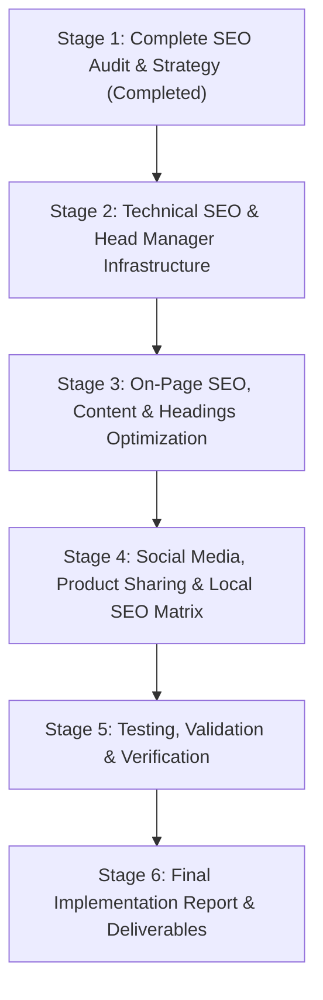

# GOODNEWS CAKE AND CATERING
## COMPREHENSIVE TECHNICAL SEO, LOCAL DISCOVERY, AND SOCIAL OPTIMIZATION AUDIT
**Document ID:** `SEO-AUDIT-2026-STG1`  
**Application:** GoodNews Cake and Catering  
**Production URL:** `https://goodnews-cake-and-catering.vercel.app/`  
**Physical Bakery Location:** Ayat, Addis Ababa, Ethiopia  
**Verified Contact:** +251 917 559 943 | goodnewscake@gmail.com  
**Audit Date:** November 11, 2026  
**Auditor:** Senior Technical SEO Specialist & Frontend Architect  

---

## 1. Executive Summary

This comprehensive audit evaluates the search engine discoverability, local search readiness, social media presentation, and technical SEO infrastructure of **GoodNews Cake and Catering**.

GoodNews Cake and Catering is an artisanal bakery based in Ayat, Addis Ababa, crafting handcrafted cakes (wedding, birthday, holiday, anniversary, custom designs), cupcakes, cookies, and premium event catering buffets.

### Key Audit Findings
1. **Single-Page Application (SPA) Meta Tag Bottleneck:**  
   The application is built on React 18 with client-side routing (`react-router-dom` v6). While `PublicLayout.jsx` dynamically updates `document.title` on client-side navigation, **meta descriptions, canonical URLs, Open Graph tags, and Twitter Cards remain static** in `public/index.html`. As a result, search engine crawlers and social media scrapers (Facebook, WhatsApp, Twitter, Telegram, Pinterest) receive identical generic homepage metadata for all subpages (`/gallery`, `/catering`, `/custom-order`, etc.).
2. **Canonical URL Duplication Flaw:**  
   The static `index.html` specifies `<link rel="canonical" href="https://goodnews-cake-and-catering.vercel.app/" />`. Because this is never changed on route navigation, any search crawler evaluating the canonical link on `/gallery`, `/catering`, or `/custom-order` is instructed that those subpages are duplicates of the homepage.
3. **Structured Data Limitation:**  
   A single static `Bakery` JSON-LD block is hardcoded in `index.html`. While valid for the homepage, subpages lack specialized schemas such as `Service` (for Catering and Custom Cake Studio), `CollectionPage` / `ItemList` (for Gallery, Cupcakes, Cookies, Seasonal), `AboutPage`, and `BreadcrumbList`.
4. **Sitemap & Robots.txt Discrepancy:**  
   `public/sitemap.xml` lists `/track-order`, but the actual application route in `App.js` is `/track`. Furthermore, `/track` is explicitly disallowed in `robots.txt` because order lookup is a private transactional utility, not an indexable commercial page. The sitemap must be cleaned to exclude non-indexable utility URLs.
5. **Product-Level Social Sharing Gap:**  
   Cake and catering items open in an in-page modal without updating the URL query parameters (e.g. `?cake=...` or `/gallery?item=...`). Customers cannot share a direct link to a specific cake or catering package with customized preview images and descriptions on WhatsApp or social media.
6. **Social Media Link Placeholder in Footer:**  
   While the official Facebook profile (`https://web.facebook.com/profile.php?id=61575509915632`) is correctly linked, the Instagram icon links to generic `https://www.instagram.com` without an official handle.
7. **Strong Existing Foundations:**  
   - Core Web Vitals foundation is excellent following the recent WebP derivative image generation, responsive `<OptimizedImage>` picture markup, and font loading optimizations.
   - Rich, authentic product descriptions, ingredient breakdowns, and serving sizes exist in the catalog.
   - Official brand logo and multi-resolution favicons (`favicon.ico`, `favicon.svg`, `apple-touch-icon.png`, `logo192.png`, `logo512.png`) are fully implemented.

---

## 2. Technical Architecture & Hosting Review

| Component | Current Technology | SEO & Crawling Implication |
| :--- | :--- | :--- |
| **Framework** | React 18.2.0 (SPA) | Client-side DOM rendering. Googlebot executes JavaScript, but Bing, social scrapers, and preview bots require instant head meta tags or pre-rendered snapshots. |
| **Routing** | `react-router-dom` v6.20.1 | Clean HTML5 pushState URLs (`/gallery`, `/catering`, `/custom-order`). All rewrite to `/index.html` via `vercel.json`. |
| **Hosting** | Vercel Serverless Edge | Fast global edge CDN with HTTP/2 and HTTP/3 support, SSL/TLS, and Brotli/Gzip compression. |
| **Backend & Storage** | Firebase Firestore & Storage | Dynamic product and review catalog, fast cloud asset delivery. |
| **Asset Caching** | Immutable cache headers | Static JS/CSS and `/images/` configured with `Cache-Control: public, max-age=31536000, immutable`. |

---

## 3. Public Route Indexability Matrix

| Route | Primary Content | Current Status | Indexability Recommendation |
| :--- | :--- | :--- | :--- |
| `/` | Homepage, Hero, Features, Testimonials | Indexable | **INDEX, FOLLOW** (Primary Brand Landing) |
| `/gallery` | Artisanal Cake Catalog, Filterable Designs | Indexable | **INDEX, FOLLOW** (Core Commercial Cake Landing) |
| `/custom-order` | Multi-step Custom Cake Studio | Indexable | **INDEX, FOLLOW** (High Intent Custom Cake Ordering) |
| `/catering` | Catering Buffets, Dessert Tables, Packages | Indexable | **INDEX, FOLLOW** (Commercial Catering Hub) |
| `/seasonal` | Ethiopian Holiday Cakes (Enkutatash, Gena, Fasika) | Indexable | **INDEX, FOLLOW** (Cultural & Seasonal Holiday Hub) |
| `/cupcakes` | Handcrafted Gourmet Cupcake Sets | Indexable | **INDEX, FOLLOW** (Product Category Landing) |
| `/cookies` | Artisanal Fresh Baked Cookies | Indexable | **INDEX, FOLLOW** (Product Category Landing) |
| `/about` | Bakery Story, Philosophy, Location, Team | Indexable | **INDEX, FOLLOW** (Brand Trust & Local E-E-A-T) |
| `/reviews` | Verified Customer Reviews & Testimonials | Indexable | **INDEX, FOLLOW** (Social Proof & Reputation) |
| `/cart` | Shopping Bag & Order Checkout | Disallowed in `robots.txt` | **NOINDEX, FOLLOW** (Transactional Utility) |
| `/track` | Order Status Tracking by Order Number | Disallowed in `robots.txt` | **NOINDEX, FOLLOW** (Private Utility) |
| `/track/:orderNumber` | Dynamic Order Tracking Details | Disallowed in `robots.txt` | **NOINDEX, NOFOLLOW** (Private Customer Data) |
| `/profile` | Customer Profile & Saved Info | Private Auth | **NOINDEX, NOFOLLOW** (Private Customer Data) |
| `/admin/*` | Administrative Management Dashboard | Role Protected | **NOINDEX, NOFOLLOW** (Disallowed in `robots.txt`) |

---

## 4. Metadata & Document Head Audit

### A. Title Tags
- **Current Behavior:** `src/components/layout/PublicLayout.jsx` updates `document.title` via a `PAGE_TITLES` dictionary on client navigation.
- **Evaluation:** Titles are descriptive and professional, but several can be refined to better balance brand name, primary keyword, and local modifier within the 55–60 character threshold.
- **Recommended Titles:**
  - `/`: `GoodNews Cake & Catering | Artisanal Bakery in Addis Ababa` (58 chars)
  - `/gallery`: `Artisanal Cake Gallery | GoodNews Cake Addis Ababa` (50 chars)
  - `/custom-order`: `Custom Cake Studio Addis Ababa | GoodNews Cake` (46 chars)
  - `/catering`: `Catering Services Addis Ababa | GoodNews Cake & Catering` (56 chars)
  - `/seasonal`: `Ethiopian Holiday Cakes | GoodNews Cake Addis Ababa` (51 chars)
  - `/cupcakes`: `Gourmet Cupcakes Addis Ababa | GoodNews Cake & Catering` (55 chars)
  - `/cookies`: `Artisanal Fresh Cookies | GoodNews Cake Addis Ababa` (51 chars)
  - `/about`: `Our Story & Bakery in Ayat | GoodNews Cake Addis Ababa` (54 chars)
  - `/reviews`: `Customer Reviews & Ratings | GoodNews Cake Addis Ababa` (53 chars)

### B. Meta Descriptions
- **Current Issue:** Only one meta description exists in `public/index.html`. Subpages display no unique meta description to search engines.
- **Solution Required:** A dedicated `<SEOHead>` component or lightweight document head manager that dynamically updates:
  1. `<meta name="description" content="...">`
  2. `<link rel="canonical" href="...">`
  3. `<meta property="og:title" content="...">`
  4. `<meta property="og:description" content="...">`
  5. `<meta property="og:url" content="...">`
  6. `<meta property="og:image" content="...">`
  7. `<meta name="twitter:title" content="...">`
  8. `<meta name="twitter:description" content="...">`
  9. `<meta name="twitter:image" content="...">`

---

## 5. Structured Data & Schema.org Audit

### Current Schema:
- Single `Bakery` schema in `public/index.html` with business name, logo, phone (+251917559943), email, Ayat address, and opening hours (Mon-Sun 8:00 AM - 6:00 PM).

### Missing Schemas to Implement:
1. **`WebSite` Schema with SearchAction:** Enhances site identity in Google Search Knowledge Panels.
2. **`BreadcrumbList` Schema:** Provides structured navigational crumbs in Google Search snippets for subpages.
3. **`Service` Schema on `/catering`:** Outlines event catering, dessert table setups, and buffet services.
4. **`Service` Schema on `/custom-order`:** Details custom artisanal cake design services.
5. **`CollectionPage` / `ItemList` Schema on `/gallery`, `/cupcakes`, `/cookies`, `/seasonal`:** Structures visible product offerings with verified sizes, descriptions, and photography.
6. **`AboutPage` Schema on `/about`:** Reinforces E-E-A-T and local community commitment.

---

## 6. XML Sitemap & Robots.txt Audit

### Issues Identified:
1. **Sitemap Discrepancy:** Line 52 of `public/sitemap.xml` references `/track-order`, but the actual application route is `/track`.
2. **Inclusion of Non-Indexable Utilities:** Transactional or tracking routes must not reside in the XML sitemap.
3. **Missing Canonical URL Alignment:** All sitemap URLs must strictly match the canonical URL structure (canonical protocol and domain `https://goodnews-cake-and-catering.vercel.app`).
4. **Robots.txt Cleanliness:** `public/robots.txt` appropriately disallows `/admin/`, `/admin`, `/cart`, and `/track`, and declares the sitemap location.

---

## 7. Heading Hierarchy & On-Page Content Review

| Page | Current H1 Tag | Hierarchy Evaluation | On-Page Recommendations |
| :--- | :--- | :--- | :--- |
| `/` (Home) | `Celebrate Life's Sweet Moments` | Clean H1. H2 sections present. | Add subtle location indicator ("in Addis Ababa") into hero subtitle or section header to reinforce local search context. |
| `/gallery` | `Artisanal Cake Gallery` | Single H1, category filter buttons. | Add crawlable introductory paragraph highlighting celebration, wedding, and birthday cakes in Addis Ababa. |
| `/custom-order` | `Custom Cake Studio` | Multi-step interactive builder. | Ensure step headings use appropriate H2/H3 hierarchy and retain crawlable cake type options. |
| `/catering` | `Catering & Dessert Packages` | Single H1, package filter tabs. | Ensure service packages have structured headings and crawlable serving capacity details. |
| `/seasonal` | `Ethiopian Holiday & Seasonal Cakes` | Single H1, festival cards. | Highlight Enkutatash, Gena, and Fasika cultural occasions with clear crawlable headings. |
| `/cupcakes` | `Gourmet Handcrafted Cupcakes` | Single H1, product grid. | Maintain clear flavor and box size text. |
| `/cookies` | `Fresh Artisanal Cookies` | Single H1, product grid. | Highlight freshly baked batches and premium natural ingredients. |
| `/about` | `About GoodNews Cake` | Single H1, H3 values, H2 story. | Strengthen location mention: Ayat neighborhood, Addis Ababa. |
| `/reviews` | `Customer Reviews & Testimonials` | Single H1, review form & cards. | Ensure customer reviews are crawlable and marked up cleanly. |

---

## 8. Local SEO & Google Business Profile Readiness

### Verified Business NAP (Name, Address, Phone):
- **Name:** GoodNews Cake & Catering
- **Physical Address:** Ayat, Addis Ababa, Ethiopia
- **Phone:** +251 917 559 943
- **Email:** goodnewscake@gmail.com
- **Operating Hours:** Monday – Sunday, 8:00 AM – 6:00 PM East Africa Time (UTC+3)
- **Primary Service Areas:** Addis Ababa (Ayat, CMC, Bole, Kazanchis, Sarbet, Summit, Piassa, Old Airport)

### Google Business Profile Optimization Action Plan:
1. **Category Selection:** Primary: *Bakery* (`Bakery`). Secondary: *Cake shop* (`Cake Shop`), *Catering food and drink supplier* (`Catering Service`).
2. **Service Area Declaration:** Define delivery coverage across all sub-cities of Addis Ababa.
3. **Photo Optimization:** Upload real high-resolution photographs of wedding cakes, celebration cakes, and catering tables.
4. **Website Link:** Connect directly to `https://goodnews-cake-and-catering.vercel.app/`.

---

## 9. Social Media & Open Graph Discovery

1. **Facebook:** Active official page at `https://web.facebook.com/profile.php?id=61575509915632`.
2. **Instagram:** Footer currently links to `https://www.instagram.com`. Must be updated with verified official handle once confirmed.
3. **Product-Level Deep Link Sharing:**  
   Implement URL query parameter synchronization (e.g., `/gallery?cake=semi-naked-cherry-chocolate-drip-cake` or `/catering?package=grand-continental-dessert-buffet`) so that when a customer shares a product link on WhatsApp or social media:
   - The recipient opens directly to that specific cake/service detail view.
   - The page title reflects the product name.
   - The share preview displays that product's specific image and description.

---

## 10. Recommended 6-Stage Implementation Plan

### Next Actions:
- **Stage 2:** Build a robust, lightweight dynamic head manager (`src/components/common/SEOHead.jsx`) that updates title, meta description, canonical URL, Open Graph, and Twitter metadata per route. Correct `sitemap.xml` and validate `robots.txt`.
- **Stage 3:** Enhance on-page headings, intro copy, and crawlable text across all 9 public pages.
- **Stage 4:** Implement product-level shareable URL params and local SEO structured data.
- **Stage 5:** Run automated regression tests, schema validation, and build verification.
- **Stage 6:** Deliver all 10 required reports in `SEO_OPTIMIZATION/`.
